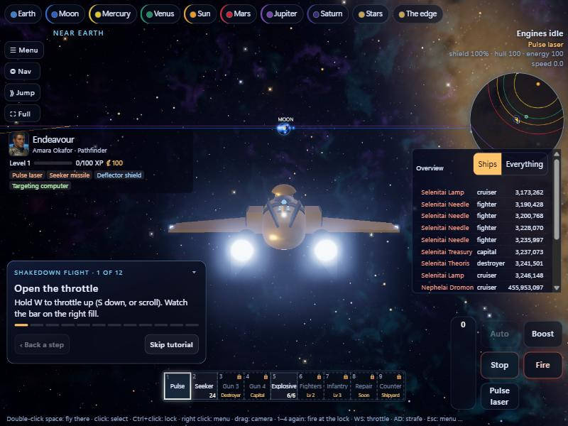
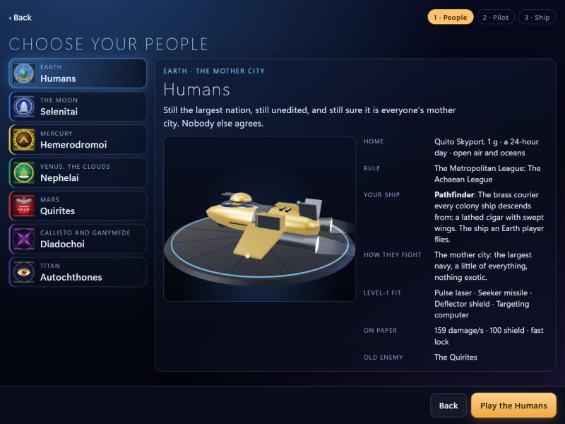
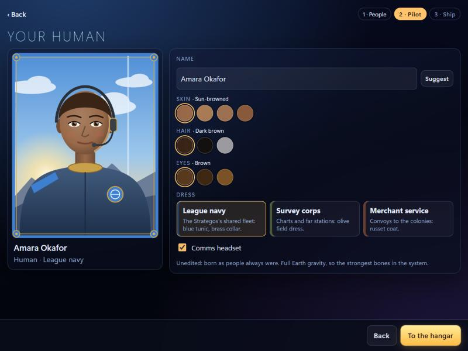

# Ascent Flight

**[▶ Play it in your browser](https://calebschalesky-ops.github.io/ascent/)**: desktop, phone or gamepad. No install.

A 3D space game set across the Solar System. Seven peoples (Earth, the Moon, Mercury, Venus, Mars, Callisto/Ganymede, Titan) each have their own government, navy, ship designs and old enemy. You build a pilot, fit a ship, and fly from a shakedown flight up to fleet battles.

**React · TypeScript · three.js · Vite · ~51,500 lines · 947 tests passing · 435 commits in 5 days**



| Choose your people | Build your pilot |
|---|---|
|  |  |

## What's in it

- **Flight:** cursor or drag steering, logarithmic throttle, boost, flight assist, touch joystick, gamepad. Bodies are sized to scale with one another.
- **Combat:** lasers, seeker missiles with locks, shields, hardpoints, fighters, destroyers, boarding with drills and infantry.
- **Fleet battles:** an AI admiral, morale, maneuvers, comms, a tactical view and a director camera.
- **Peoples and progression:** seven nations, a pilot creator, ship fitting, levels and a shipyard.
- **Balance by simulation:** `npm run balance` and `npm run sim` run headless battles, so tuning changes are measured, not guessed. `PKG-24` is a luck audit of whether fights are decided by decisions or dice.

## How it was built

I ran it as a small studio of Claude Code agents, each with a defined seat. One head of development wrote the work packages and integrated the results. Engine, balance, content, art and QA each got their own seat.

- **Work packages** (`packages/`): 30+ scoped briefs, PKG-01 to PKG-26 plus QA and re-score passes. Each one names the files it may touch, the acceptance bar, and the evidence it has to file.
- **Reports** (`reports/`): every package files its gate evidence (test runs, screenshots, measured numbers) before it gets merged.
- **Cold-play QA** (`QA-05`): a separate agent plays the build as a first-time player and files every break with repro steps. It fixes nothing itself.
- **Territory enforced in code:** each agent can only write its own files. A pre-tool hook enforces this rather than a line in a prompt.

My job was the vision, the rulings and the bar for "done". The agents built to it in parallel git worktrees, and an integration branch merged their work.

## Run it locally

```bash
npm install
npm run dev
npm test          # 947 tests
npm run build
```

In development, `window.__voyage` drives the flight from the console (`run(seconds)`, `enter(dest)`, `snap()`, `setWeapon`), which is how the agents tested flight without a human at the keyboard.

`SPEC.md` is the design contract. `vision/`, `TIMELINE.md` and the research files are the world and its history.
